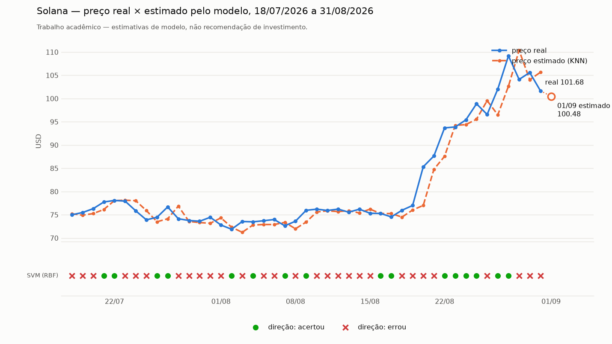

# Previsões × preço real — Solana

**Trabalho acadêmico.** As previsões abaixo são estimativas de modelos estatísticos a partir de padrões passados, condicionadas ao período analisado. Não são previsão confiável do mercado nem recomendação de investimento.

- Gerado em: `2026-11-17T00:23:23+00:00`
- Período comparado: **18/07/2026 a 31/08/2026** (45 dias com preço real conhecido)
- Modelos: direção `SVM (RBF)` · preço `KNN`
- Preços: instantâneos diários de 00:00 UTC (CoinGecko), em USD

## Resumo

|  | resultado |
| --- | --- |
| Direção (sobe / não sobe) | **16 de 45** dias classificados corretamente (36%) |
| Por acaso (moeda honesta) | entre 16 e 29 acertos em 95% das vezes |
| Erro médio do preço estimado | 1.84 USD (2.1%) |
| Erro de "amanhã = hoje" (persistência) | 1.71 USD (2.0%) |

> A taxa de acerto da direção está **dentro** da faixa do acaso: não se distingue de cara-ou-coroa. O preço estimado **não** errou menos que simplesmente repetir o preço de hoje — resultado esperado no horizonte de um dia.

**Próximo dia (01/09/2026, ainda não aconteceu):** direção classificada como **baixa/estável**; preço estimado **100.48 USD** (-1.18% sobre 101.68 USD).

## Gráfico

## Dia a dia

Cada linha foi prevista **antes** de o dia acontecer: o modelo foi treinado só com os dias anteriores. *Véspera* é o preço do dia anterior (o ponto de partida); *erro* = estimado − real.

| dia | véspera (USD) | estimado (USD) | real (USD) | erro | variação real | direção classificada | direção real | acertou? |
| --- | --- | --- | --- | --- | --- | --- | --- | --- |
| 18/07/2026 | 75.27 | 75.21 | 75.00 | +0.21 (+0.3%) | -0.4% | alta | baixa/estável | ✗ |
| 19/07/2026 | 75.00 | 74.91 | 75.48 | -0.57 (-0.8%) | +0.6% | baixa/estável | alta | ✗ |
| 20/07/2026 | 75.48 | 75.26 | 76.31 | -1.06 (-1.4%) | +1.1% | baixa/estável | alta | ✗ |
| 21/07/2026 | 76.31 | 76.14 | 77.75 | -1.61 (-2.1%) | +1.9% | alta | alta | ✓ |
| 22/07/2026 | 77.75 | 78.05 | 78.09 | -0.03 (-0.0%) | +0.4% | alta | alta | ✓ |
| 23/07/2026 | 78.09 | 78.13 | 77.94 | +0.19 (+0.2%) | -0.2% | alta | baixa/estável | ✗ |
| 24/07/2026 | 77.94 | 78.03 | 75.85 | +2.18 (+2.9%) | -2.7% | alta | baixa/estável | ✗ |
| 25/07/2026 | 75.85 | 75.90 | 73.91 | +1.99 (+2.7%) | -2.6% | alta | baixa/estável | ✗ |
| 26/07/2026 | 73.91 | 73.50 | 74.48 | -0.97 (-1.3%) | +0.8% | alta | alta | ✓ |
| 27/07/2026 | 74.48 | 74.14 | 76.69 | -2.55 (-3.3%) | +3.0% | alta | alta | ✓ |
| 28/07/2026 | 76.69 | 76.87 | 74.14 | +2.72 (+3.7%) | -3.3% | alta | baixa/estável | ✗ |
| 29/07/2026 | 74.14 | 73.57 | 73.77 | -0.21 (-0.3%) | -0.5% | alta | baixa/estável | ✗ |
| 30/07/2026 | 73.77 | 73.33 | 73.61 | -0.28 (-0.4%) | -0.2% | alta | baixa/estável | ✗ |
| 31/07/2026 | 73.61 | 73.18 | 74.46 | -1.29 (-1.7%) | +1.2% | baixa/estável | alta | ✗ |
| 01/08/2026 | 74.46 | 74.34 | 72.79 | +1.54 (+2.1%) | -2.2% | alta | baixa/estável | ✗ |
| 02/08/2026 | 72.79 | 72.33 | 71.89 | +0.43 (+0.6%) | -1.2% | baixa/estável | baixa/estável | ✓ |
| 03/08/2026 | 71.89 | 71.23 | 73.55 | -2.32 (-3.2%) | +2.3% | baixa/estável | alta | ✗ |
| 04/08/2026 | 73.55 | 72.79 | 73.49 | -0.70 (-1.0%) | -0.1% | baixa/estável | baixa/estável | ✓ |
| 05/08/2026 | 73.49 | 72.90 | 73.71 | -0.81 (-1.1%) | +0.3% | baixa/estável | alta | ✗ |
| 06/08/2026 | 73.71 | 72.90 | 73.99 | -1.08 (-1.5%) | +0.4% | baixa/estável | alta | ✗ |
| 07/08/2026 | 73.99 | 73.36 | 72.63 | +0.73 (+1.0%) | -1.8% | baixa/estável | baixa/estável | ✓ |
| 08/08/2026 | 72.63 | 71.99 | 73.62 | -1.62 (-2.2%) | +1.4% | baixa/estável | alta | ✗ |
| 09/08/2026 | 73.62 | 73.43 | 75.96 | -2.53 (-3.3%) | +3.2% | alta | alta | ✓ |
| 10/08/2026 | 75.96 | 75.61 | 76.21 | -0.61 (-0.8%) | +0.3% | baixa/estável | alta | ✗ |
| 11/08/2026 | 76.21 | 75.85 | 75.92 | -0.08 (-0.1%) | -0.4% | alta | baixa/estável | ✗ |
| 12/08/2026 | 75.92 | 75.69 | 76.22 | -0.53 (-0.7%) | +0.4% | baixa/estável | alta | ✗ |
| 13/08/2026 | 76.22 | 75.88 | 75.56 | +0.32 (+0.4%) | -0.9% | alta | baixa/estável | ✗ |
| 14/08/2026 | 75.56 | 75.39 | 76.20 | -0.81 (-1.1%) | +0.9% | baixa/estável | alta | ✗ |
| 15/08/2026 | 76.20 | 76.21 | 75.34 | +0.88 (+1.2%) | -1.1% | alta | baixa/estável | ✗ |
| 16/08/2026 | 75.34 | 75.27 | 75.28 | -0.01 (-0.0%) | -0.1% | baixa/estável | baixa/estável | ✓ |
| 17/08/2026 | 75.28 | 75.26 | 74.55 | +0.71 (+1.0%) | -1.0% | baixa/estável | baixa/estável | ✓ |
| 18/08/2026 | 74.55 | 74.51 | 75.97 | -1.47 (-1.9%) | +1.9% | baixa/estável | alta | ✗ |
| 19/08/2026 | 75.97 | 76.03 | 77.00 | -0.98 (-1.3%) | +1.4% | baixa/estável | alta | ✗ |
| 20/08/2026 | 77.00 | 77.02 | 85.33 | -8.32 (-9.7%) | +10.8% | baixa/estável | alta | ✗ |
| 21/08/2026 | 85.33 | 84.79 | 87.65 | -2.86 (-3.3%) | +2.7% | baixa/estável | alta | ✗ |
| 22/08/2026 | 87.65 | 87.57 | 93.69 | -6.12 (-6.5%) | +6.9% | alta | alta | ✓ |
| 23/08/2026 | 93.69 | 94.23 | 93.88 | +0.34 (+0.4%) | +0.2% | alta | alta | ✓ |
| 24/08/2026 | 93.88 | 94.39 | 95.41 | -1.01 (-1.1%) | +1.6% | alta | alta | ✓ |
| 25/08/2026 | 95.41 | 95.55 | 98.87 | -3.32 (-3.4%) | +3.6% | alta | alta | ✓ |
| 26/08/2026 | 98.87 | 99.55 | 96.58 | +2.98 (+3.1%) | -2.3% | alta | baixa/estável | ✗ |
| 27/08/2026 | 96.58 | 96.50 | 102.05 | -5.55 (-5.4%) | +5.7% | alta | alta | ✓ |
| 28/08/2026 | 102.05 | 102.66 | 109.18 | -6.52 (-6.0%) | +7.0% | alta | alta | ✓ |
| 29/08/2026 | 109.18 | 110.36 | 104.11 | +6.25 (+6.0%) | -4.6% | alta | baixa/estável | ✗ |
| 30/08/2026 | 104.11 | 104.05 | 105.59 | -1.55 (-1.5%) | +1.4% | baixa/estável | alta | ✗ |
| 31/08/2026 | 105.59 | 105.65 | 101.68 | +3.97 (+3.9%) | -3.7% | alta | baixa/estável | ✗ |
| **01/09/2026** | 101.68 | **100.48** | aguardando | — | — | **baixa/estável** | aguardando |  |

## Como os modelos foram escolhidos

`TimeSeriesSplit` com 5 partições sobre os 229 dias **anteriores** ao período comparado — nenhum dia da tabela acima participou da escolha.

**Direção** (critério: maior acurácia balanceada média; 0,5 = acaso):

| modelo | acurácia balanceada média | desvio |
| --- | --- | --- |
| SVM (RBF) | 0.528 | 0.034 |
| Perceptron | 0.516 | 0.028 |
| KNN | 0.496 | 0.063 |
| Árvore de decisão | 0.457 | 0.054 |
| Naive Bayes | 0.454 | 0.046 |

**Preço** (critério: menor RMSE médio do retorno diário):

| modelo | RMSE médio do retorno | desvio |
| --- | --- | --- |
| Baseline: retorno zero | 0.0337 | 0.0079 |
| KNN | 0.0350 | 0.0070 |
| SVR (RBF) | 0.0356 | 0.0111 |
| Árvore de decisão | 0.0450 | 0.0164 |
| Ridge (linear) | 0.0630 | 0.0463 |

## Ressalvas

- "Amanhã" é o próximo instantâneo de 00:00 UTC, não o fechamento de um pregão.
- O preço estimado parte do preço da véspera, por isso acompanha de perto a curva real: o que importa é o erro comparado ao de repetir o preço de hoje.
- Cada linha usa um modelo reajustado só com o passado, então a tabela não é uma medida otimista de dentro da amostra — mas o período é curto e não sustenta conclusões sobre o futuro.
