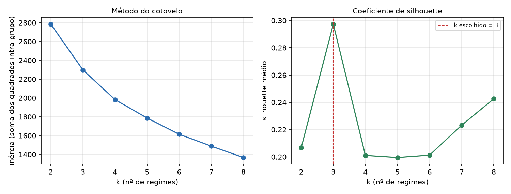
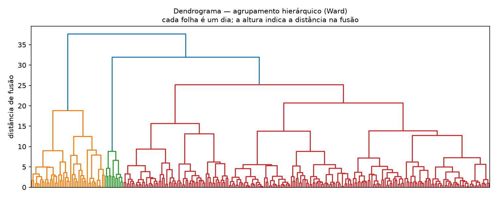
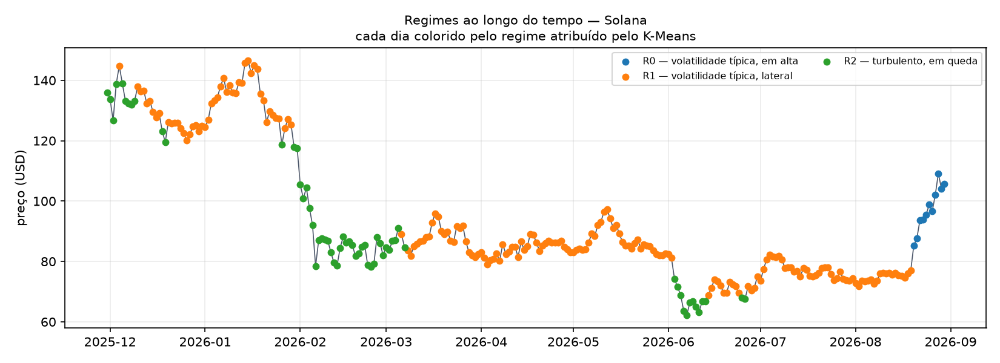
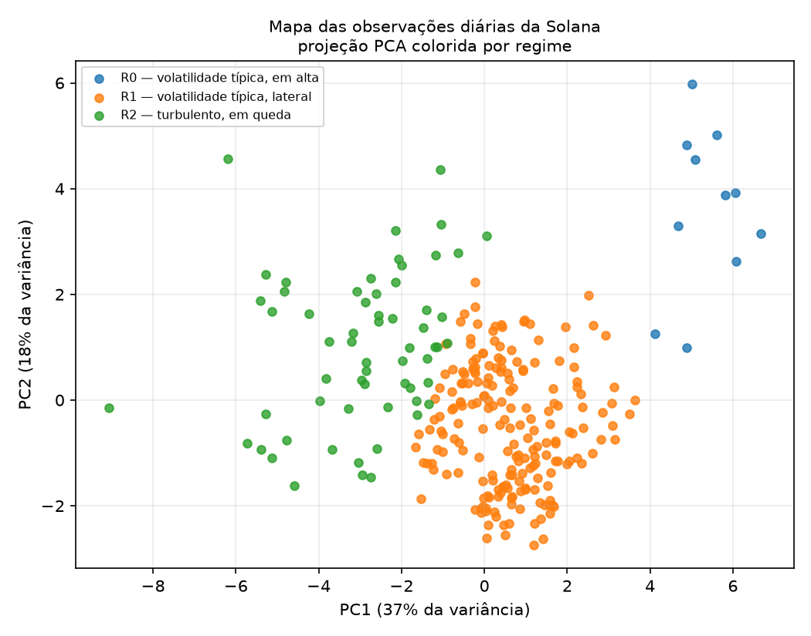

# Regimes temporais da Solana — Encontros 8-9

**Trabalho acadêmico.** Os regimes são grupos estatísticos de dias com atributos parecidos, não categorias oficiais de mercado nem sinais de investimento.

- Gerado em: `2026-09-01T01:11:19+00:00`
- Entrada: `data\processed\atributos.parquet`
- Período: **2025-11-30 a 2026-08-30** (274 dias, 13 atributos)
- Semente fixa: `42`

## Reenquadramento: agrupar tempo, não ativos

Com um único ativo não existe "mapa entre criptomoedas". Cada **dia** vira um ponto de 13 dimensões e o agrupamento procura **regimes**: estados recorrentes do mercado. O mapa da apostila vira a projeção PCA das observações diárias, colorida por regime.

## 1. Escolha do número de regimes (k)

| k | inércia | silhouette |
| --- | --- | --- |
| 2 | 2784.296 | 0.207 |
| 3 | 2297.940 | 0.297 |
| 4 | 1983.016 | 0.201 |
| 5 | 1786.997 | 0.200 |
| 6 | 1614.488 | 0.201 |
| 7 | 1488.479 | 0.223 |
| 8 | 1367.807 | 0.243 |

> **k = 3** foi escolhido pelo maior silhouette médio — critério objetivo e reprodutível. O cotovelo confirma visualmente: a inércia cai rápido no início e depois achata, sem um joelho nítido (típico de dados contínuos, sem grupos naturalmente separados).

> O dendrograma mostra a estrutura hierárquica: cada folha é um dia e a altura da fusão indica quão distantes os grupos estavam. Cortar em alturas diferentes produz mais ou menos regimes.

## 2. Perfil dos regimes (K-Means)

Média de cada atributo por regime, em unidades originais. É aqui que os grupos ganham significado:

| regime | interpretação | dias | ret_1d | ret_30d | vol_30d | dist_mm_30 | drawdown | razao_vol_cap |
| --- | --- | --- | --- | --- | --- | --- | --- | --- |
| 0 | volatilidade típica, em alta | 11 | 0.030 | 0.293 | 0.028 | 0.239 | -0.606 | 0.092 |
| 1 | volatilidade típica, lateral | 202 | 0.001 | -0.000 | 0.028 | 0.003 | -0.622 | 0.052 |
| 2 | turbulento, em queda | 61 | -0.012 | -0.270 | 0.043 | -0.150 | -0.628 | 0.087 |

> A coluna *interpretação* vem de uma heurística explícita (`nomear_regimes`): a média de `vol_30d` e `ret_30d` de cada regime é posicionada nos **tercis da distribuição diária**. Usar os tercis dos dias — e não a mediana entre as médias dos regimes — evita que o regime central se compare consigo mesmo, e abre uma faixa intermediária (*lateral*, *volatilidade típica*) em vez de forçar todo regime a um extremo. É um rótulo legível, não uma classificação teórica.

## 3. Coerência temporal

Um regime que descreve um *estado* deve ocupar trechos contíguos. Se aparecesse espalhado em dezenas de blocos de um dia, seria ruído diário:

| regime | dias | blocos contíguos | maior bloco | primeiro dia | último dia |
| --- | --- | --- | --- | --- | --- |
| 0 | 11 | 1 | 11 | 2026-08-20 | 2026-08-30 |
| 1 | 202 | 8 | 87 | 2025-12-04 | 2026-08-19 |
| 2 | 61 | 8 | 35 | 2025-11-30 | 2026-06-26 |

## 4. O mapa (PCA)

> As duas primeiras componentes explicam **56%** da variância (PC1 37%, PC2 18%). O mapa é uma sombra 2D de um espaço de 13 dimensões — grupos que parecem sobrepostos podem estar separados nas dimensões não mostradas.

**Atributos que mais pesam em cada componente:**

| atributo | PC1 | PC2 |
| --- | --- | --- |
| dist_mm_30 | 0.428 | 0.053 |
| ret_30d | 0.392 | -0.135 |
| ret_7d | 0.359 | 0.237 |
| dist_mm_7 | 0.333 | 0.293 |
| ret_acum | 0.296 | -0.135 |
| assimetria_30 | 0.290 | 0.209 |
| cruz_mm | 0.280 | -0.028 |
| vol_7d | -0.236 | 0.410 |
| vol_30d | -0.224 | 0.433 |
| ret_1d | 0.182 | 0.274 |
| razao_vol_cap | -0.166 | 0.353 |
| curtose_30 | 0.074 | 0.455 |
| drawdown | 0.034 | 0.110 |

## 5. Comparação entre os três métodos

| método | silhouette |
| --- | --- |
| K-Means | 0.297 |
| Hierárquico (Ward) | 0.325 |
| DBSCAN (só pontos agrupados) | 0.289 |

**Concordância entre partições (índice de Rand ajustado):**

| par de métodos | ARI |
| --- | --- |
| K-Means x Hierárquico | 0.736 |
| K-Means x DBSCAN | 0.109 |
| Hierárquico x DBSCAN | 0.062 |

> ARI = 1 significa partições idênticas; ARI ≈ 0, concordância ao acaso. Métodos que concordam sugerem que a estrutura encontrada é do dado, não do algoritmo.

**Grade de busca do DBSCAN** (`min_samples` = 8):

| eps | grupos | fração de ruído | silhouette |
| --- | --- | --- | --- |
| 1.500 | 4 | 0.701 | — |
| 1.750 | 6 | 0.467 | — |
| 2.000 | 5 | 0.325 | 0.289 |
| 2.250 | 4 | 0.219 | 0.230 |
| 2.500 | 2 | 0.135 | 0.274 |
| 2.750 | 1 | 0.109 | — |
| 3.000 | 1 | 0.062 | — |
| 3.250 | 1 | 0.047 | — |
| 3.500 | 1 | 0.047 | — |
| 3.750 | 1 | 0.047 | — |
| 4.000 | 1 | 0.011 | — |
| 4.250 | 1 | 0.011 | — |
| 4.500 | 1 | 0.007 | — |
| 4.750 | 1 | 0.004 | — |
| 5.000 | 1 | 0.004 | — |

> O DBSCAN não obriga todo dia a pertencer a um grupo: dias em regiões esparsas viram **ruído** (`-1`). Esses dias atípicos são a matéria-prima da detecção de anomalias do Encontro 12.

## 6. Ressalvas metodológicas

**Observações não são independentes.** Dias consecutivos compartilham janelas móveis (uma média de 30 dias muda pouco de um dia para o outro), então pontos vizinhos no tempo são parecidos por construção. Isso infla a coerência temporal dos regimes e torna o silhouette otimista — ele mede separação geométrica, não descoberta de estados independentes.

**Não há regimes "verdadeiros" para comparar.** O agrupamento é não supervisionado: não existe gabarito. Silhouette e ARI medem consistência interna, não acerto.

**Os regimes descrevem o passado analisado.** Eles resumem o período coletado e não implicam que os mesmos estados voltarão, nem em que ordem.

**k é uma escolha, não uma descoberta.** A ausência de cotovelo nítido indica que os dias formam um contínuo, não grupos naturalmente separados. O k adotado é o corte mais defensável pelo silhouette dentro da faixa testada (2–8), não um número intrínseco ao mercado.
